# Anania Sileshi

Full-Stack Web Developer in Addis Ababa, Ethiopia. Information Science student at Haramaya University.

**Portfolio: [anani.me](https://anani.me)**

## What I build

- Full-stack web apps: typed React/Next.js front-ends wired to real back-ends, auth, and databases
- Developer tools and automation: scripts, CLIs, and AI-powered workflows
- System design and integrations that hold up as products grow

## Stack

TypeScript · React · Next.js · Node.js · Python · MySQL · MongoDB · Firebase · Tailwind

## Selected projects

| Project | What it is |
|---|---|
| [TibebStore](https://github.com/ananiasileshi/TibebStore) | E-commerce platform for handcrafted works with polished checkout and curated discovery |
| [CryptoPriceTracker](https://github.com/ananiasileshi/CryptoPriceTracker) | Real-time crypto dashboard with live market updates and clear analytics |
| [AddisHotel](https://github.com/ananiasileshi/AddisHotel) | Hotel management system for reservations, inventory, and guest workflows |
| [ChessGame](https://github.com/ananiasileshi/ChessGame) | Cross-device browser chess engine with responsive board controls |
| [ExpenseTracker](https://github.com/ananiasileshi/ExpenseTracker) | Personal finance app for tracking spending, budgets, and savings insights |
| [T2V](https://github.com/ananiasileshi/T2V) | Text-to-video generation tool with an AI-first creation flow |
| [SnakeGame](https://github.com/ananiasileshi/SnakeGame) | Classic Snake reimagined with smooth animation and responsive controls |
| [JARVIS](https://github.com/ananiasileshi/JARVIS) | Python assistant for intelligent automation and developer workflows |

## Contact

- Email: contact@anani.me
- Telegram: [@ananiasileshi](https://t.me/ananiasileshi)
- LinkedIn: [in/ananiasileshi](https://www.linkedin.com/in/ananiasileshi/)

Open to freelance builds, internships, and remote collaboration.
